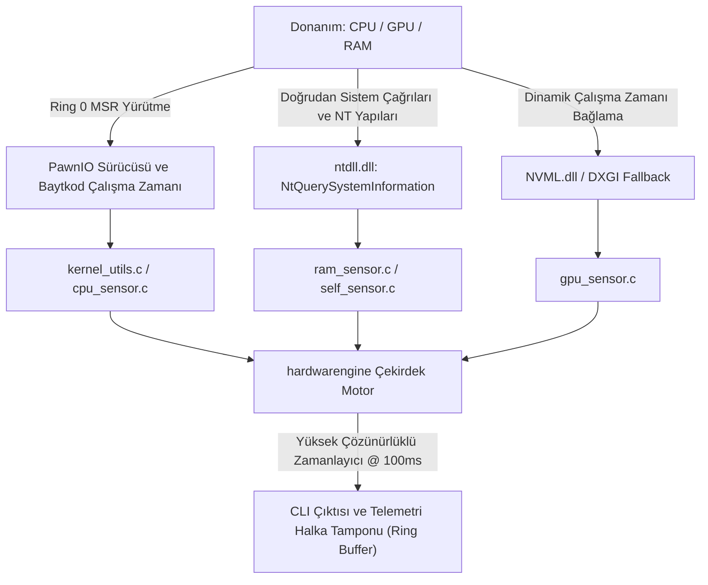

<div align="center">

# hardwarengine

[](https://en.wikipedia.org/wiki/C99)
[](https://www.microsoft.com/windows)
[](https://github.com/namazso/PawnIO)
[](https://github.com/ismailemret/hardwarengine/actions/workflows/github-code-scanning/codeql)
[](PROPRIETARY_LICENSE)

<p><strong>Windows x64 için mikrosaniye gecikmeli, sıfır ek yük getiren (zero-overhead) düşük seviyeli donanım telemetri motoru ve oyun içi HUD arka ucu.</strong></p>

<p><a href="README.md">English</a> • <a href="README_TR.md">Türkçe</a></p>

</div>

<a name="turkce"></a>
## Türkçe

WMI, COM ve CIM gibi yavaş, yüksek ek yük (overhead) üreten işletim sistemi soyutlama katmanlarını tamamen baypas etmek üzere saf C99 ile geliştirilmiş düşük seviyeli telemetri motorudur. Gerçek donanım çalışma metriklerini mikrosaniye altı gecikmeyle, ihmal edilebilir CPU/RAM ayak iziyle elde etmek amacıyla doğrudan Ring 0 Model-Specific Register (MSR) erişimi, yerel Windows NT sistem çağrıları (syscall) ve dinamik donanım sürücüsü bağlamaları kullanır.

### Sistem Mimarisi ve Veri Akışı



### Telemetri İşlem Hattı ve Metrik Özellikleri

| Alt Sistem | Metrik | Birincil Kaynak / Mekanizma | Hedef Gecikme | Ek Yük (Overhead) |
| --- | --- | --- | --- | --- |
| **CPU Çekirdek** | Mimari Efektif Saat Frekansı | MSR (`IA32_APERF` / `IA32_MPERF`, `MSR_PLATFORM_INFO` veya P0 Tabanı ile normalize) | Mikrosaniye altı | $\approx 0$ döngü |
| **CPU Termal** | Dijital Termal Sensör (DTS) | MSR (`IA32_THERM_STATUS` / AMD `MSR_AMD_HARDWARE_THERMAL` + TjMax) | Mikrosaniye altı | $\approx 0$ döngü |
| **CPU Güç** | RAPL Paket Enerjisi ve VID | MSR (`MSR_PKG_ENERGY_STATUS` türevi ve `IA32_PERF_STATUS` VID) | Mikrosaniye altı | $\approx 0$ döngü |
| **CPU Yükü** | Dinamik Sistem/Çekirdek Farkları | `NtQuerySystemInformation` (`SystemProcessorPerformanceInformation`) | $< 10\,\mu\text{s}$ | Sıfır bellek ayırma |
| **GPU (Harici)** | Saat Hızları, Sıcaklık, VRAM, Güç | NVML Dinamik Çalışma Zamanı API'si (`nvml.dll`) | $< 50\,\mu\text{s}$ | Dinamik bağlama |
| **Çekirdek Havuzları** | Sayfalanan ve Sayfalanmayan Havuz | `NtQuerySystemInformation` (`SystemPerformanceInformation`) | $< 5\,\mu\text{s}$ | Sıfır bellek ayırma |
| **Sistem Belleği** | Fiziksel, Donanıma Ayrılmış ve Commit | `GlobalMemoryStatusEx` + `GetPhysicallyInstalledSystemMemory` | $< 5\,\mu\text{s}$ | Minimal |
| **Öz-Profilleme** | Çalışma Kümesi (Working Set) ve CPU | `K32GetProcessMemoryInfo` + `GetProcessTimes` | $< 10\,\mu\text{s}$ | Dahili takip |

### Temel Mimari İlkeler

* **Modern Çekirdek Köprüsü (PawnIO Entegrasyonu):** Eski ve güvenlik açığı barındıran sürücü yığınları (WinRing0 vb.) yerine, Windows HVCI (Hipervizör Korumalı Kod Bütünlüğü) ve Çekirdek Yalıtımı (Core Isolation) ile tam uyumlu **PawnIO** kullanır. Ring 0 MSR okuma işlemleri, `PawnIOLib.dll` üzerinden doğrudan imzalı baytkod modülleri (`IntelMSR.bin`, `AMDFamily17.bin`) aracılığıyla yürütülür.
* **Sıfır Soyutlama Hattı (Zero-Abstraction Pipeline):** WMI/CIM altyapısının neden olduğu 100–300 ms gecikmeleri ve yüksek bağlam değişimi (context-switch) yüklerini tamamen ortadan kaldırır.
* **Hibrit Çekirdek ve Topoloji Haritalama:** Sistem topolojisini `GetLogicalProcessorInformationEx` ile dinamik olarak tarayarak Intel Performans/Verimlilik (P/E) çekirdeklerini ve AMD Zen CCX yapılarını iş parçacığı (thread) bazında haritalar.
* **Saf Mimari Efektif Saat Frekansları:** İşletim sisteminin hedef çarpan tahminlerini baypas eder. Donanım yürütme döngülerini, Intel tarafında `MSR_PLATFORM_INFO` (`0xCE`) temel veri yolu oranıyla, AMD Zen tarafında ise P-State 0 (`0xC0010064`) tabanıyla APERF/MPERF donanım sayaç farkları üzerinden normalize eder.
* **Donanım Seviyesi Güç Modellemesi:** İşlemci paket enerjisini donanımsal RAPL (Running Average Power Limit) birimleri (`MSR_RAPL_POWER_UNIT` / `MSR_PKG_ENERGY_STATUS`) üzerinden takip eder; gerçek matematiksel türevi ($\Delta E / \Delta t$) `QueryPerformanceCounter` hassasiyetiyle hesaplar.
* **Derin Windows NT Bellek Muhasebesi:** Sistem donanımına ayrılmış fiziksel adres uzayını, commit yüklerini, sayfa hatası farklarını ve çekirdek bellek havuzlarını (Sayfalanan Havuz / Sayfalanmayan Havuz) yerel NT yapıları (`HW_SYSTEM_PERFORMANCE_INFO`) üzerinden doğrudan yakalar.
* **Deterministik Çekirdek Zamanlayıcı:** Dahili 2.0 saniyelik hareketli ortalama akümülatörü ile `CreateWaitableTimerExW` (Yüksek Çözünürlüklü Zamanlayıcı API'si) kullanarak 100 ms (10 Hz) frekansta sabit aralıklı çalışır.
* **Ultra Düşük Kaynak Tüketimi:** Dış çalışma zamanı bağımlılığı olmaksızın saf Win32/NT yürütmesi sağlar (test edilen değerler: `< 5 MB` Working Set, `< %0.04` CPU kullanımı).

### Alt Sistem Detayları

* **CPU ve Ring 0 MSR Katmanı**
* Sistem kayıt defterinden (Registry) `PawnIOLib.dll` kütüphanesini dinamik olarak bulur ve bağlar. `ioctl_read_msr` yürütmek için iş parçacığı eğilimini (thread affinity) mantıksal çekirdeğe kilitler.
* **Intel Çözümleme:** `0x1A2` (`IA32_TEMPERATURE_TARGET` TjMax), `0x19C` (`IA32_THERM_STATUS` DTS ve PROCHOT/Termal Kısılma bayrakları), `0x198` (`IA32_PERF_STATUS` VID / 8192.0f), `0x0CE` (`MSR_PLATFORM_INFO` Veri Yolu Oranı), `0x0E7`/`0x0E8` (`IA32_APERF`/`IA32_MPERF` efektif frekans), `0x606` (`MSR_RAPL_POWER_UNIT`) ve `0x611` (`MSR_PKG_ENERGY_STATUS`).
* **AMD Zen Çözümleme:** `0xC0010064` (`MSR_AMD_PSTATE_0` FID/DID/VID çözümleme), `0xC0010293` (`MSR_AMD_HARDWARE_THERMAL` Tctl/Tdie ofsetleri ve termal kısılma biti), `0x0E7`/`0x0E8` (`APERF`/`MPERF`), `0xC0010299` (`MSR_AMD_RAPL_PWR_UNIT`) ve `0xC001029A` (`MSR_AMD_CORE_ENERGY_STAT`).
* **Çekirdek Yükü:** `ntdll.dll` üzerinden doğrudan `NtQuerySystemInformation` (`SystemProcessorPerformanceInformation`) çözümlenmesi.


* **GPU Telemetri Katmanı**
* `LoadLibraryA` / `GetProcAddress` aracılığıyla çalışma zamanında dinamik olarak `nvml.dll` kütüphanesini bağlar (bağlama zamanı bağımlılığı sıfırdır).
* Hibrit/NVIDIA Optimus dizüstü sistemlerindeki Windows RTD3 / D3Cold uyku geçişlerini ve PCIe bağlantı kopmalarını yöneten durum makinesi içerir (`NVML_ERROR_GPU_IS_LOST`, `NVML_ERROR_DRIVER_NOT_LOADED`).
* **NVIDIA (NVML):** Çekirdek/Bellek saat hızları, Çekirdek/Hotspot sıcaklıkları, Fan devri (gömülü denetleyici/EC mimarileri için sessiz hata toleranslı), TGP güç çekişi (mW $\rightarrow$ W) ve aktif VRAM kullanım ayak izi.
* **DirectX Fallback:** NVML bulunmadığında temel bağdaştırıcı tanımlama ve VRAM telemetrisi için planlanan `dxgi.dll` (`IDXGIFactory` / `IDXGIAdapter`) yedek hattı.


* **Bellek ve Motor Öz-Profilleme**
* **RAM ve Çekirdek Tahsisleri:** `GlobalMemoryStatusEx` üzerinden fiziksel RAM kullanımı, `GetPhysicallyInstalledSystemMemory` ile ACPI/iGPU ayrılmış bellek hesabı ve `NtQuerySystemInformation` (`SystemPerformanceInformation`) ile derin çekirdek bellek takibi (Sayfalanan Havuz, Sayfalanmayan Havuz, Commit Toplamı ve Commit Sınırı).
* **Motor Öz-Metrikleri:** `GetProcessTimes` ve `K32GetProcessMemoryInfo` (Working Set & Private Commit Boyutu) aracılığıyla motorun kendi kaynak tüketimini takip eden dahili profilleyici.


---

### Gereksinimler ve Bağımlılıklar

`hardwarengine` motorunu çalıştırmak veya derlemek için gereken sistem bileşenleri:

1. **İşletim Sistemi:** Windows 10 / 11 64-bit (x64 mimarisi).
2. **Yürütme Yetkileri:** **Yönetici olarak çalıştırma (Elevated Administrator)** gereklidir (Ring 0 sürücü tanıtıcılarını açmak ve NT çekirdek sorgularını yürütmek için zorunludur).
3. **PawnIO Sürücüsü (Çekirdek Servisi):**
* HVCI uyumlu Ring 0 MSR erişimi için gereklidir.
* Windows Paket Yöneticisi (winget) ile doğrudan kurulum:
```cmd
winget install -e --id namazso.PawnIO

```


* Veya resmi yayın sayfasından imzalı yükleyiciyi manuel indirin: [PawnIO Releases](github.com/namazso/PawnIO/releases) / [PawnIO Resmi Web Sitesi](https://pawnio.eu/).


4. **MSR Baytkod Modülleri:**
* `IntelMSR.bin` (Intel Core 2. Nesil ile 14.+ Nesil arası).
* `AMDFamily17.bin` (AMD Zen 1 ile Zen 5 mimarileri arası).
* Her iki ikili dosya da `hardwarengine.exe` ile aynı dizinde bulunmalıdır.


5. **NVIDIA Ekran Kartı Sürücüsü (GPU Telemetrisi İçin İsteğe Bağlı):**
* `nvml.dll` içeren standart NVIDIA GeForce / RTX Kurumsal sürücüleri (`System32` veya `Program Files\NVIDIA Corporation\NVSMI` altında).


---

### Kaynaktan Derleme

#### Gerekli Geliştirici Araçları

* **Microsoft Visual C++ (MSVC) v143+** (Visual Studio 2022 C++ x64 Build Tools).
* **Windows 10 / 11 SDK** (Windows Kaynak Derleyicisi `rc.exe` ve standart Win32 başlık dosyaları için).

#### Derleme Talimatları

1. **Visual Studio / VS Code Üzerinden:**
* Proje ana dizinini açın.
* `Ctrl + Shift + B` kısayolu ile derleme görevini tetikleyin (`scripts\build.bat` çalıştırılır).


2. **Yerel Komut Satırı Üzerinden:**
* `x64 Native Tools Command Prompt for VS 2022` konsolunu açın.
* Derleme betiğini çalıştırın:
```cmd
scripts\build.bat

```


* Derlenen ikili dosya `bin\hardwarengine.exe` konumuna aktarılır.


---

### Paketleme ve Kurulum

Son kullanıcılar için bağımsız kurulum paketi oluşturmak amacıyla:

1. Paketleme betiğini çalıştırın:
```cmd
scripts\package_installer.bat

```


2. Betik; `hardwarengine.exe`, `PawnIOLib.dll`, baytkod modülleri (`IntelMSR.bin`, `AMDFamily17.bin`) ve yetki manifestolarını sıkıştırarak tek bir `Setup.exe` oluşturur.
3. `Setup.exe` çalıştırıldığında, arka planda UAC onaylı bir Windows Görev Zamanlayıcı görevi kaydeder ve küresel başlatma kısayolunu atar:
```text
[ Ctrl + Alt + Z ]

```


---

### Proje Yol Haritası ve Planlanan Yetenekler

* [x] Ring 0 MSR tabanlı CPU frekans, sıcaklık, voltaj ve kısılma durumu takibi (Intel/AMD)
* [x] Donanımsal RAPL paket güç tüketimi türev hesabı ($\Delta E / \Delta t$)
* [x] Win32 yüksek çözünürlüklü deterministik çekirdek zamanlayıcısı (100 ms) ve hareketli ortalama filtresi
* [x] Yerel NT API bellek sorguları (Sayfalanan/Sayfalanmayan Havuzlar, Donanıma Ayrılmış Bellek, Commit Sınırları)
* [x] RTD3 uyku geri kazanımı destekli çalışma zamanı dinamik NVML GPU katmanı (Çekirdek, Bellek, Saatler, Sıcaklık, Güç)
* [ ] NVIDIA harici grafik kartları için DirectX DXGI / D3DKMT yedek telemetri hattı
* [ ] Direct3D / Vulkan swapchain kancası (hook) ile düşük ek yüklü oyun içi HUD katmanı
* [ ] Gömülü Denetleyici (EC) tabanlı dinamik fan eğrisi ve güç limiti yönetimi
* [ ] Gerçek zamanlı donanım darboğazı ve termal kısılma algılama motoru